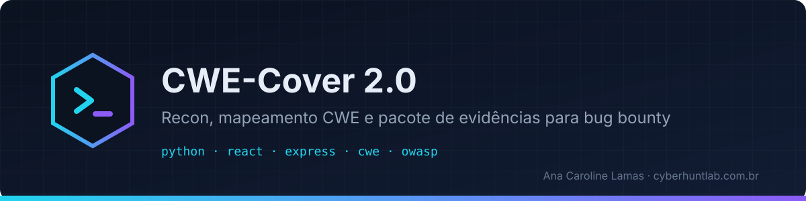

<p align="center"></p>

# CWE-Cover 2.0 — triagem de segurança, mapeamento CWE e pacote de evidências

Suíte de **segurança defensiva e bug bounty** da CyberHuntLab. O núcleo é uma CLI em **Python** (`cwe_discover.py`) que exige **autorização explícita** e, opcionalmente, um arquivo de **escopo**. Ela faz reconhecimento, aplica regras declarativas, classifica os achados por **MITRE CWE** e passa cada um por **agentes** de mapeamento, falso positivo e impacto antes de gerar o relatório e um **pacote ZIP de evidências**. O repositório inclui também o **Cyber Hunter Engine** (17 motores nativos, sem scanners externos) e um **painel web** (React + Express) com campanhas, licenças e administração.

## Recursos

### CLI `cwe_discover.py`

- **Autorização obrigatória** (`--i-have-authorization`), arquivo de escopo JSON (`--scope-file`) e contexto da plataforma (`--platform hackerone|bugcrowd|intigriti`).
- **Motores nativos** opcionais:
  - `--subdomains`: enumeração passiva por Certificate Transparency e OSINT;
  - `--probe`: probing HTTP e identificação de tecnologias;
  - `--rules`: regras e matchers declarativos;
  - `--crawl-native`: rotas REST, formulários e scripts;
  - `--standalone-all`: tudo junto.
- **Uso de ferramentas externas, se instaladas**: subfinder, httpx, katana, nuclei e aquatone são detectados com `shutil.which`; sem elas, a etapa é registrada como indisponível e a execução continua.
- **Pipeline de agentes** (`--agents`) com fluxo evidence-first: detecção → evidência → validação da regra → PoC segura (cURL ou script) → análise → classificação → relatório. Cada achado traz o que foi comprovado, o que **não** foi e a avaliação de falso positivo.
- **Relatórios** em Markdown, formato HackerOne, JSON, CSV ou HTML, além do pacote `reports/<alvo>/<data>.zip` com achados por CWE, evidências, screenshots, PoCs e logs.
- **Narrativa opcional por IA local** (`--ai-narrative`, Ollama) sem alterar as evidências; upload opcional ao Google Drive.
- Controles de ritmo: `--max-depth`, `--max-urls` e `--delay`.

### Cyber Hunter Engine (`cyber_hunter.py`)

17 motores em pipeline: rede e portas (CH-NET, CH-SPEEDNET), DNS, HTTP/TLS, crawling, auditoria web, descoberta de conteúdo, fuzzing, AppSec (sessões, JWT, CORS), detecção por regras, validação diferencial, correlação, CWE, OWASP, impacto (CVSS v3.1), evidências e relatório. Subcomandos `scan`, `agents`, `rules`, `doctor` e `version`.

### Painel web (`server.ts` + `src/`)

React 19 + Express com campanhas de varredura (criar, iniciar, pausar, retomar, exportar), ativação por licença, planos e pagamento por PIX, administração (licenças, usuários, sessões, auditoria) e diagnóstico do Ollama.

## Instalação

Requisitos: **Python 3.9+**; para o painel, **Node.js 20+**.

```bash
git clone https://github.com/ticarollamas-arch/CWE-Cover-2.0.git
cd CWE-Cover-2.0
pip install -e .            # instala os comandos chl / cyber-hunter (sem dependências externas)
npm install                 # opcional: painel web
cp .env.example .env        # PORT, ADMIN_DEFAULT_EMAIL, ADMIN_DEFAULT_PASS, OLLAMA_ENDPOINT
```

## Como usar

```bash
# Varredura com pacote de evidências
python cwe_discover.py -u https://alvo-autorizado.example --i-have-authorization

# Com plataforma, escopo e agentes
python cwe_discover.py -u https://alvo-autorizado.example --i-have-authorization \
  --platform bugcrowd --scope-file examples/scope_example.json --agents --standalone-all

# Cyber Hunter Engine
python cyber_hunter.py scan https://alvo-autorizado.example --full --i-have-authorization -f md -o relatorio.md
python cyber_hunter.py doctor

# Testes
python -m pytest -q

# Painel web
npm run dev
```

Guias complementares: [AI_SETUP.md](AI_SETUP.md) (Ollama e CrewAI), [GDRIVE_SETUP.md](GDRIVE_SETUP.md) e [INSTRUCOES_HOSPEDAGEM.md](INSTRUCOES_HOSPEDAGEM.md).

## Uso responsável

Use apenas em alvos próprios ou dentro do escopo de um programa de bug bounty. Os módulos de portas, fuzzing e AppSec fazem **testes ativos**: confira as regras do programa antes de ativá-los. Os achados são indicadores para triagem humana; a IA só redige a narrativa e não cria evidências.

## Tecnologias

Python · asyncio · pytest · MITRE CWE · OWASP Top 10 · CVSS v3.1 · Ollama · CrewAI · Google Drive API · React 19 · TypeScript · Vite · Tailwind CSS · Express

## Licença

Distribuído sob a licença MIT. Veja [LICENSE](LICENSE) (Copyright © 2026 Carol Lamas / CyberHuntLab).
